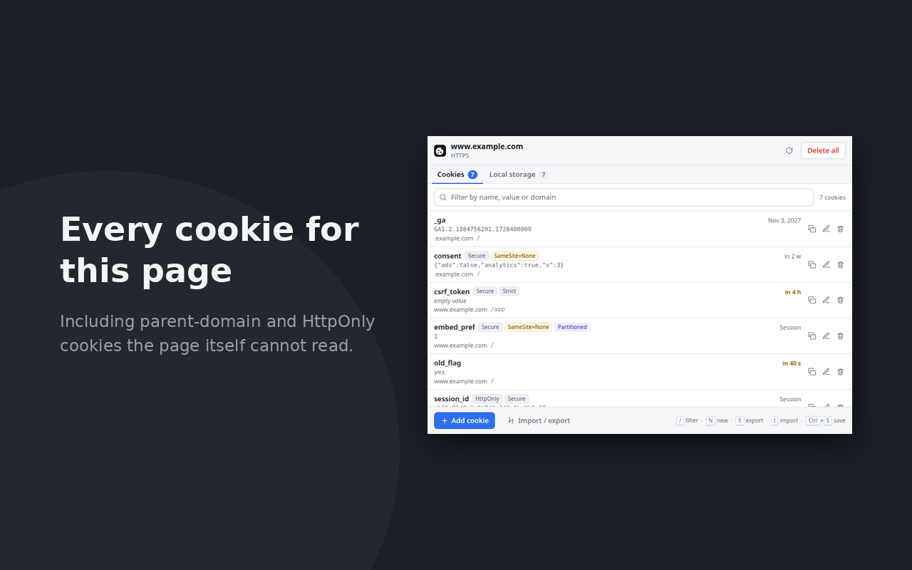

# Cookie & LocalStorage Editor by HomieLab

Quick edit the cookies and `localStorage` of the tab you are on: view, add,
edit, delete, import and export them without leaving the page. Built for
developing and testing sites, and for clearing out tracking cookies by hand.

Everything is scoped to the current site. No background process, no network
access, no analytics.

## Installing

**From the Chrome Web Store:** search for _Cookie & LocalStorage Editor by HomieLab_.

**From source:** the extension is plain files in `src/` and runs unbuilt.

- **Chrome, Edge, Brave, Opera:** open `chrome://extensions`, turn on
  **Developer mode**, choose **Load unpacked** and select the `src` directory.
- **Firefox:** open `about:debugging#/runtime/this-firefox`, choose **Load
  Temporary Add-on…** and select `src/manifest.json`.

Requires Chrome 119 or Firefox 128. To work on `file://` pages in Chrome, also
turn on **Allow access to file URLs** on the extension's details page.

## Using it

Click the toolbar icon. The popup has two tabs, **Cookies** and **Local
storage**, each with its count; switch with a click or <kbd>1</kbd> /
<kbd>2</kbd>. It reopens on the tab you last used.

| Action          | How                                                                         |
| --------------- | --------------------------------------------------------------------------- |
| Quick edit      | Click a row: the value is selected, ready to type over                      |
| Save            | <kbd>Ctrl</kbd>+<kbd>Enter</kbd>, <kbd>Ctrl</kbd>+<kbd>S</kbd> or **Save**  |
| Add             | **Add cookie** / **Add item**, or <kbd>N</kbd>                              |
| Delete          | The bin icon on a row, or **Delete all** for the whole site; both ask first |
| Filter          | Type in the search box, or <kbd>/</kbd>; <kbd>Esc</kbd> clears it           |
| Copy a value    | The copy icon on a row                                                      |
| Import / export | **Import / export**, or <kbd>E</kbd> / <kbd>I</kbd>                         |
| Close           | <kbd>Esc</kbd>                                                              |

### Cookies

The list shows every cookie the browser would send to the page, including
parent-domain cookies and `HttpOnly` cookies that page scripts cannot see. The
editor covers every attribute: value, domain, path, expiry, `SameSite`,
`Secure`, `HttpOnly` and `Partitioned` (CHIPS), plus **Duplicate** for trying a
second value side by side.

- Changing a cookie's name, domain, path or partition replaces it rather than
  adding a second one; if the browser rejects the change, the original is put
  back.
- `SameSite=None` and `Partitioned` switch `Secure` on, since browsers reject
  them without it.
- **Export** as lossless JSON, or as a `Cookie` header string
  (`session=abc; theme=dark`) for pasting into a request. **Import** reads
  either back, including the `{"cookies": [...]}` shape other cookie editors
  export. A paste with one unreadable cookie is refused as a whole, and
  cookies for other domains are never written.

### Local storage

The list shows the page's `localStorage` by key, with each item's size and a
**JSON** badge for JSON values.

- **Format JSON** switches a value between indented and one line.
- Renaming a key moves the item rather than copying it.
- **Export** is a JSON object of keys and values; **Import** merges one back,
  or replaces everything when _Replace_ is ticked.
- Writes are all or nothing: if the site's storage quota runs out part way,
  the page is left as it was. A write is refused if the tab has moved to
  another site since it was read.

## Permissions and privacy

Installing shows no warning and grants access to no website.

| Permission             | Why                                                                          |
| ---------------------- | ---------------------------------------------------------------------------- |
| `cookies`              | Read and write cookies.                                                      |
| `activeTab`            | See which site the tab you opened the popup on is showing.                   |
| `scripting`            | Read and write the page's `localStorage`, which only exists inside the page. |
| Host access, on demand | Asked for per site the first time you open the popup there.                  |

On a new site the popup offers **Allow on this site** or **Allow on all
sites**. Either opens a small window that lists the hosts being asked for, then
the browser's own confirmation; afterwards it returns you to the tab. Access
can be taken back at any time from the browser's extensions menu.

Nothing leaves your computer. See the [privacy policy](PRIVACY.md).

## Contributing

Bug reports and pull requests are welcome; see [CONTRIBUTING.md](CONTRIBUTING.md)
for setup, tests and how the code is laid out. Changes are listed in
[CHANGELOG.md](CHANGELOG.md).

## Support

If it saves you time, you can [support HomieLab on Ko-fi](https://ko-fi.com/homielab). The heart in the popup links
there too.

## Licence

[MIT](LICENSE) © [HomieLab](https://homielab.com) · [contact@homielab.com](mailto:contact@homielab.com)
